<p align="center">
  
</p>

<h1 align="center">Infórmate y Decide · Elecciones Colombia 2026</h1>

<p align="center">
  <em>Política para dummies: un quiz de afinidad electoral que te conecta con <strong>ideas</strong>, no con apellidos.</em>
</p>

<p align="center">
  
  
  
</p>

<!-- 🔗 Demo: agrega aquí el enlace a la versión publicada (por ejemplo GitHub Pages) -->
<!-- 🎞️ Presentación del proyecto: https://canva.link/r1mt5mg9xwmvaev -->

---

## 📌 Sobre el proyecto

**Infórmate y Decide** nació como respuesta a un reto de **pedagogía electoral para una decisión consciente** de cara a las elecciones presidenciales de Colombia 2026. La propuesta es una campaña llamada **"Pensamos, sentimos y participamos"**, y este repositorio contiene su herramienta principal: **Simula tu voto**.

**Simula tu voto** plantea **40 preguntas en lenguaje cotidiano, sin tecnicismos**, sobre **20 temas del país**. Con las respuestas calcula qué tan afín es la persona a cada propuesta y a cada uno de los **5 candidatos**. Los nombres de los candidatos no aparecen hasta el final, para que se vote por las ideas y no por la cara.

> 🎞️ **Presentación del proyecto:** [PDF](Reto.pdf) · [Canva](https://canva.link/r1mt5mg9xwmvaev)

## 🧑‍🎓 ¿Para quién es?

La campaña está dirigida a **estudiantes universitarios de 18 a 25 años en Colombia**, representados en dos *buyer personas*: **Manu** y **Juanse**. Son jóvenes que llegan a las elecciones con dos problemas: **ansiedad electoral** y **poco conocimiento** sobre las propuestas, los actores políticos y el proceso de votación.

Por eso la solución apela a la razón y a la emoción al mismo tiempo:

| Logos · *Un ejercicio informado* | Pathos · *Un ejercicio esperanzador* |
|---|---|
| Que el votante entienda qué propone cada candidato y cómo funciona el proceso electoral. | Que votar se sienta posible y no abrumador, reduciendo la ansiedad que genera decidir. |

## 🎯 Objetivos

1. **Reducir en un 20 % la ansiedad electoral** de los estudiantes que participen en la campaña, medida con una escala tipo Likert aplicada antes y después de la intervención, en un periodo de 4 semanas.
2. **Aumentar en un 30 % el conocimiento** sobre propuestas, actores políticos y proceso electoral en el mismo periodo, mediante herramientas interactivas y contenidos educativos.

Para medirlos se aplican encuestas **antes y después** de interactuar con la campaña y con la herramienta. Los resultados se comparan pregunta por pregunta con un **análisis estadístico de muestras pareadas**.

## 🧩 Líneas de acción

| | 📺 El VAR de tu Decisión | 🗳️ Simula tu voto *(este repositorio)* |
|---|---|---|
| **Qué es** | Contenidos cortos (Reels, carruseles, TikTok) y un stand en el Punto Verde donde se "revisan jugadas" del proceso electoral. | Una experiencia interactiva para hacer *match* con propuestas, conocer a los candidatos y sus planes de gobierno. |
| **Contenido** | ¿Cómo votar paso a paso? · Mitos vs. realidad · "Si sientes esto, es normal" (normalización emocional). | El usuario responde preguntas, ve con qué **propuestas** conecta (no con qué candidatos) y recibe un resultado explicativo que no le impone nada. |
| **KPIs** | Video completion rate ≥ 40 % · Guardados en contenido educativo ≥ 15 % · −20 % en la percepción de "no entiendo el proceso". | Tiempo promedio en la herramienta ≤ 5 min · ≥ 25 % de usuarios reportan más claridad para decidir. |

**Canales:** redes sociales propias, grupos de WhatsApp de facultades, stand en el Punto Verde y la landing page de la herramienta.

## 📅 Plan de implementación (4 semanas)

| Actividad | Semana 1 | Semana 2 | Semana 3 | Semana 4 |
|---|---|---|---|---|
| Desarrollo de *Simula tu voto* | Ajustes UX/UI + testeo | Lanzamiento | Optimización según uso | Análisis de datos |
| Pruebas piloto | Test con usuarios + feedback | Ajustes menores | | |
| Contenido *El VAR de tu Decisión* | Grabación y edición | Publicación continua | Publicación continua | |
| Campaña en redes | | Campaña activa | Campaña activa | Cierre + recopilación |
| Stand Punto Verde | Planeación logística | Activación diaria | Activación diaria | Cierre + encuestas |
| Encuestas pre / post | Línea base | | | Aplicación final |
| Monitoreo de KPIs | | Seguimiento parcial | Seguimiento parcial | Análisis final e informe |

## ✨ Funcionalidades de la herramienta

| | Funcionalidad | Descripción |
|---|---|---|
| 🗳️ | **Quiz de 40 preguntas** | Escala Likert de 5 niveles, de *"No, para nada"* a *"¡Sí, totalmente!"*. |
| 🧭 | **20 áreas temáticas** | Libertad de expresión, religión, drogas, seguridad, medio ambiente, impuestos, pensiones, salud, mercado laboral y más. |
| 📊 | **Resultados en 3 vistas** | **Lo que más te pegó** (propuestas ganadoras por tema), **Por candidato** (ranking de afinidad) y **Tema por tema** (desglose detallado). |
| 📄 | **Planes de gobierno** | Enlace directo al PDF del programa de cada candidato. |
| ⌨️ | **Accesibilidad de teclado** | Se responde con las teclas `1`–`5` y se navega con las flechas `←` `→`. |
| 📱 | **Diseño responsive** | Interfaz editorial con transiciones suaves y barras de afinidad animadas. |

## 👥 Candidatos incluidos

| Candidato | Partido / Movimiento | Perfil |
|---|---|---|
| Iván Cepeda | Pacto Histórico | Progresista / Reformista |
| Abelardo de la Espriella | Defensores de la Patria | Derecha radical |
| Paloma Valencia | Centro Democrático | Uribista / Conservadora |
| Sergio Fajardo | Dignidad & Compromiso | Centro / Tecnocrático |
| Claudia López | Independiente | Centro-izquierda / Gerencial |

Las propuestas de cada candidato se tomaron de sus planes de gobierno, que están en [`scr/Propuestas/`](scr/Propuestas).

## 🧮 ¿Cómo se calcula la afinidad?

El resultado no sale de una "caja negra". Se basa en la **similitud de vectores por producto punto** y en las 20 áreas del **diagrama de Nolan**, que ubica la posición política de una persona según cómo se para frente a cada tema:

1. Cada una de las **20 áreas** tiene **2 propuestas opuestas** (40 en total) y cada propuesta tiene su propia pregunta.
2. Cada respuesta se convierte en un valor entre **−2 y +2**.
3. La afinidad con una propuesta se calcula con un **producto punto** entre la respuesta a su pregunta y la respuesta a la pregunta de la propuesta contraria:

   ```
   dot       = 2 · respuesta_propia − 2 · respuesta_opuesta      ∈ [−8, +8]
   afinidad  = (dot + 8) / 16 × 100                              ∈ [0 %, 100 %]
   ```

4. En cada área gana la propuesta con mayor afinidad.
5. La **afinidad con un candidato** es el promedio de la afinidad con las 20 propuestas que defiende.

## 🛠️ Tecnologías

- **HTML5, CSS3 y JavaScript (vanilla):** sin frameworks ni proceso de build.
- **Google Fonts:** *Fraunces* (títulos) y *DM Sans* (texto).

## 📁 Estructura del proyecto

```
reto-informate-y-decide/
├── index.html          # Pantallas: bienvenida, quiz y resultados
├── style.css           # Estilos y animaciones
├── main.js             # Datos (áreas, propuestas, preguntas, candidatos), lógica del quiz,
│                       # cálculo de afinidad y render de resultados
├── Reto.pdf            # Presentación del proyecto
└── scr/
    ├── Reto.png        # Logo del proyecto
    ├── *.jpeg          # Fotos de los candidatos
    └── Propuestas/     # Planes de gobierno en PDF
```

## 🚀 Cómo ejecutarlo

Como es un sitio estático, basta con servirlo localmente:

```bash
git clone https://github.com/laurareyma/reto-informate-y-decide.git
cd reto-informate-y-decide

# Cualquier servidor estático sirve, por ejemplo:
python3 -m http.server 8000
# y abre http://localhost:8000
```

## 🔭 Próximos pasos

- Separar los datos (preguntas y propuestas) en archivos JSON.
- Agregar la opción de compartir el resultado en redes sociales.

## 👩‍💻 Equipo

| Integrante | Contacto |
|---|---|
| **Laura Vanesa Reyes** | [LinkedIn](https://www.linkedin.com/in/lauravanesareyes) |
| **María José Dangond** | [LinkedIn](https://www.linkedin.com/in/mar%C3%ADa-jos%C3%A9-dangond-325ab4332/) |
| **Natalia Rodríguez Melo** | — |

---

<p align="center"><sub>Una iniciativa de pedagogía electoral para Colombia 2026. Esta herramienta es informativa y no recomienda votar por ningún candidato.</sub></p>
